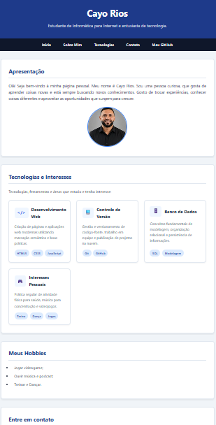

# Página Pessoal - Cayo Rios

Projeto desenvolvido para a disciplina de **Programação Web I** (IF Sudeste MG - Barbacena).

## 🚀 Tecnologias Utilizadas
- HTML5 (Semântica e Formulários)
- CSS3 (Estilização externa, seletores, classes e pseudoclasses)

### Cartões com Grid e Flexbox
